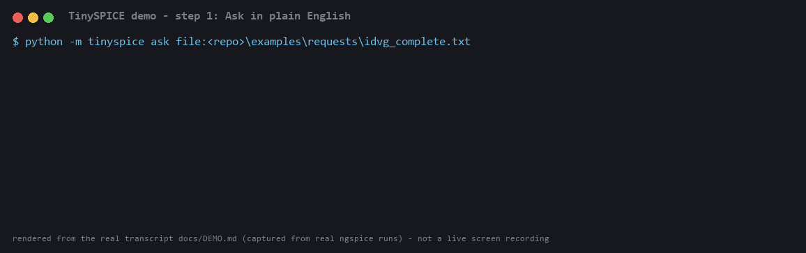
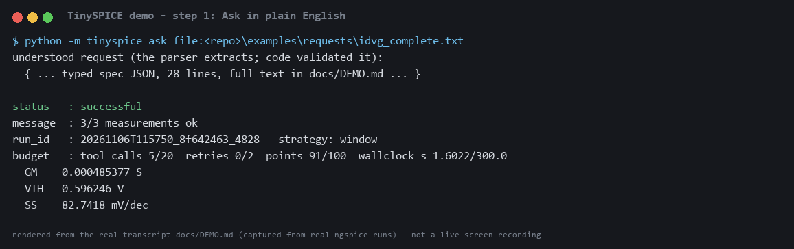
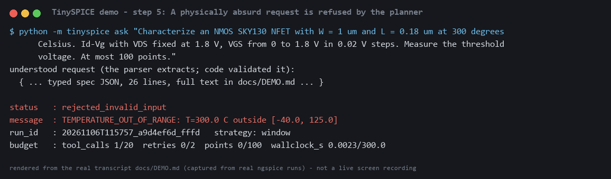
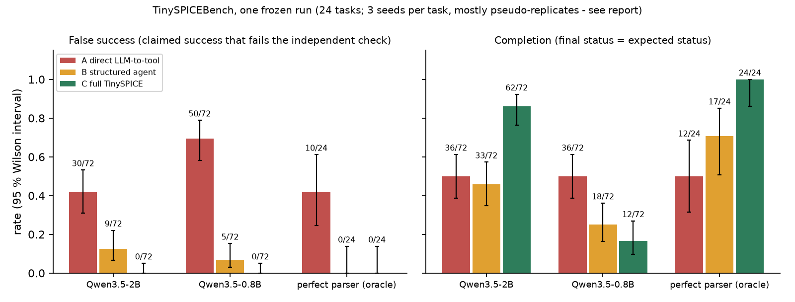

# TinySPICE

**A budget-aware, reliability-driven LLM agent for reproducible MOSFET characterization.**

TinySPICE turns a plain-English request ("NMOS SKY130 NFET, W = 1 um, L = 0.18 um, Id-Vg ... measure the threshold voltage ... at most 100 points") into a validated, budget-limited, fully recorded **ngspice** experiment.
The language model only *interprets* the text into a typed spec. Everything after that is deterministic code: validation, planning inside hard budgets, real ngspice runs, measurement extraction, recovery from named failures, and an honest final status. Every reported number comes from simulator output.

> Built in November 2026 as a single-author research project. Tested on Windows 11 only, one device family (SKY130 1.8 V NFET, `tt` corner). Read the **Limits** section before relying on any claim.

## Read first
| | |
|---|---|
| **One-page summary** | [docs/SUMMARY.md](https://github.com/pavannithin224-abcd/TinySPICE/blob/main/docs/SUMMARY.md) |
| **Project report** (about 4 pages, with figures) | [docs/REPORT.md](https://github.com/pavannithin224-abcd/TinySPICE/blob/main/docs/REPORT.md) |
| **Real demo transcript** | [docs/DEMO.md](https://github.com/pavannithin224-abcd/TinySPICE/blob/main/docs/DEMO.md) |
| **Every decision, amendment and negative result** | [docs/DECISIONS.md](https://github.com/pavannithin224-abcd/TinySPICE/blob/main/docs/DECISIONS.md) |
| **Reproduce everything** | `python scripts/reproduce.py all` (18 checks, verified from a fresh clone of this repo) |

## What it does (one real run)
```
> python -m tinyspice ask file:examples/requests/idvg_complete.txt
understood request (the parser extracts; code validated it): { ...typed spec... }
status   : successful        message : 3/3 measurements ok
budget   : tool_calls 5/20  retries 0/2  points 91/100  wallclock_s 1.6/300
  GM    0.000485 S      VTH   0.596 V      SS   82.7 mV/dec
```
`tinyspice verify <run_id>` checks every recorded artefact hash; `tinyspice replay <run_id>` re-runs the stored spec and compares measurements (rtol 1e-6).
A request that is incomplete, contradictory or physically out of range is **refused before anything is simulated**, and the refusal says why.

## Screenshots and animation
These are **renderings of the real captured transcript** (`docs/DEMO.md`, produced from real ngspice runs by `scripts/make_demo.py`; regenerate with `scripts/make_media.py`). They are not a live screen recording.



| A real run: English request to measurements | Refused before simulating (planner: 300 C is out of range) |
|---|---|
|  |  |

Result figures, generated from the committed raw results by `scripts/make_figures.py`:



Also: [sampling figure](results/figures/fig2_sampling.png), [parser figure](results/figures/fig3_parser.png). A one-page summary is `docs/SUMMARY.md`; the short report is `docs/REPORT.md`.

## Status (labels used everywhere)
**IMPLEMENTED** code exists · **MOCK-TESTED** tests against a mock simulator · **NGSPICE-TESTED** tests against real ngspice · **VERIFIED** checked against an independent reference or a pre-registered experiment with committed raw results.

| Component | State | Evidence / caveat |
|---|---|---|
| Typed experiment spec + deterministic planner (device limits, point/tool-call budgets) | NGSPICE-TESTED | unit + integration tests |
| ngspice 47 runner, SKY130 netlists, output validation, timeouts | NGSPICE-TESTED | geometry limits verified from the model bins; voltage/temperature limits **not** verified (`limits_verified=false`) |
| Measurement engine (ID, GM, GDS, VTH constant-current, SS with R-squared gate, ION, IOFF) | VERIFIED | analytic-curve tests + cross-check vs scipy on real SKY130 data |
| English -> spec parser (local llama.cpp: Qwen3.5 0.8B / 2B; SmolLM2 135M / 360M) | IMPLEMENTED, measured | small models are **safe behind the guardrails but recall is poor** (see Results) |
| Deterministic guardrails (value grounding, coverage, omitted-bias / omitted-limit checks, request conflicts) | VERIFIED on pre-registered sets | see Results |
| Measurement-aware ("window") sampling for subthreshold swing at small point counts | VERIFIED (confirmatory) | 24/24 vs 4/24 on held-out conditions |
| Curvature-adaptive sampling | **NOT SUPPORTED** (reported null) | pre-registered hypothesis H4 failed |
| Budget ledger, named-failure recovery, six-state status machine, SQLite provenance, replay | NGSPICE-TESTED | 20 pre-registered failure-injection cases, all correct |
| Recovery from a *physical* non-convergence | **NOT TESTED** | none could be provoked on this device (24 hostile runs all converged); the solver-ladder cure was verified only against an injected fault |
| TinySPICEBench (24 tasks x 3 configurations) | VERIFIED (one frozen run) | see Results |
| Bounded LLM re-ask | tried, **NOT SUPPORTED** | its safety condition failed; not part of the system |
| Other devices (PMOS, BSIM-CMG, other PDKs), other platforms | NOT IMPLEMENTED | |

## Results (reproducible: `python scripts/reproduce.py results`)
**TinySPICEBench** (24 tasks, one frozen run, Qwen3.5-2B, 72 runs per configuration; A = direct LLM-to-tool, B = structured agent, C = full TinySPICE):

| | A direct | B structured | C full |
|---|---|---|---|
| Completion (final status = expected status) | 0.50 | 0.46 | **0.86** |
| **False success** (claimed success that fails an independent check) | 30/72 | 9/72 | **0/72** |
| Budget violations / invented conditions | 7 / 12 | 3 / 9 | 0 / 0 |

Primary test (pre-registered): C beats A on false success. **Task-level** exact sign test: A-only 10, C-only 0, p = 0.001; task-cluster 95 % CI of the difference [+0.21, +0.63]. (The three seeds are mostly pseudo-replicates, so the task-level test is the honest one.) 24 of A's 30 false successes are on tasks where the right answer was to refuse or stop, so what is measured is "does it refuse or stop when it should". All 26 of C's success claims were true.
With a **perfect parser** (oracle row), A still had 42 % false success, B and C 0 %; completion 0.50 / 0.71 / 1.00. With the 0.8B model C stays safe (0 % false success) but completes only 17 % of runs.

**English -> spec, Qwen3.5-2B on a fresh 41-request set** (20 valid, 21 bad): 7 of 20 valid requests extracted exactly; the guardrails take silent-wrong from 4 to 0 and accepted-bad from 7/21 to 0/21. A small local model plus deterministic guards is **safe, but recall is about 35 %**. The 135M and 360M models extract almost nothing.

**Adaptive sampling** (held-out, 12 conditions, 24 paired cells): subthreshold-swing extraction succeeds in 24/24 with window sampling vs 4/24 with uniform sampling at 16 and 20 points (sign test p = 1e-6); VTH stays within 1.2 mV. The benefit is tied to the SS extractor's window definition.

## Quick start (Windows)
```
python -m venv .venv
.venv\Scripts\python -m pip install -e .[dev]
.venv\Scripts\python scripts\setup_tools.py            # ngspice 47 + SKY130 NFET models into .tools\ (hash-pinned, git-ignored)
.venv\Scripts\python scripts\reproduce.py quick         # tests + a real run + verify + replay (~2 min)
.venv\Scripts\python scripts\reproduce.py results       # recompute every reported table from the committed raw results (~1 min)
```
Optional, for the LLM parser (downloads hash-verified GGUF models into `.tools\models`, about 1.3 GB for the 2B):
```
.venv\Scripts\python scripts\setup_llm.py runtime
.venv\Scripts\python scripts\setup_llm.py model qwen3.5-2b
.venv\Scripts\python -m tinyspice ask --parser llm:qwen3.5-2b "<your request>"
```
Without a model, `ask` uses the rule-based floor parser (canonical phrasings only). CLI: `plan | run | ask | replay | verify | runs`; exit codes: 0 successful or recovered, 2 partial, 1 anything else.

## Design rules
* The LLM never produces a number that is used without a check; unstated values are rejected, never defaulted or guessed.
* A run is **successful** only if every requested measurement succeeded. Otherwise: `partially_completed`, `recovered_after_failure`, `failed`, `rejected_invalid_input` or `stopped_budget_limit`.
* Budgets (points, tool calls, retries, total wall-clock) are enforced by a ledger that charges *before* each action.
* Recovery is a fixed catalogue of named failures with bounded retries. It never changes `gmin` / `abstol` (that created a leakage artefact during development).
* Every experiment was pre-registered (expected results and win rules committed before running). No test set was tuned after its outputs were seen, and nulls are reported (curvature sampling, bounded re-ask).

## Limits (read these)
* **One author wrote the tasks, the system and the baselines.** Mitigations: tasks and expected outcomes frozen with hashes before the baselines existed, and tasks where the system is expected to fail are included. Author bias remains.
* **n = 24 benchmark tasks, one device family, one corner (`tt`), one platform.** Trend-level evidence, not a general claim.
* **Shared extractors:** all three configurations use the same measurement code, so the benchmark isolates orchestration, not extraction quality.
* **Small-model recall is low** (above). The parser rejects far more valid requests than it accepts wrongly: safe, not convenient.
* **Seeds:** at temperature 0.2 most prompts give identical outputs across seeds, so statistics are at task level.
* **Convergence recovery** was never exercised by a physical failure.
* **Prior art:** "LLM + SPICE" is not new (for example AnalogAgent, arXiv 2603.23910, and others). The contributions claimed here are narrower: hard budgets, bounded named-error recovery with honest status labels, a measured guardrail comparison with small local models, and measurement-aware sampling. See `docs/RESEARCH_PROBLEM.md`.

## Repository map
`src/tinyspice/` spec, planner, simulator, measurements, sampling, budget, recovery, status, provenance, agent (parser + guardrails), benchmark, CLI · `scripts/` setup, experiments, reproduction · `tests/` unit, integration, benchmark sets (frozen with sha256) · `docs/` charter, architecture, every pre-registration (`STAGE4_*`, `STAGE6B_*`, `STAGE7A_*`, `BENCH_PREREG.md`), `DECISIONS.md` · `results/` committed raw results · `PROJECT_STATUS.md`.

## Third-party components (downloaded by the setup scripts, never committed)
ngspice 47 and the SkyWater SKY130 PDK models (Apache-2.0), llama.cpp (MIT), Qwen3.5 and SmolLM2 models (Apache-2.0). Check each project's own license for the exact terms. TinySPICE itself: MIT (`LICENSE`).

Formerly "SiliconOps" (renamed 2026-11-04).
