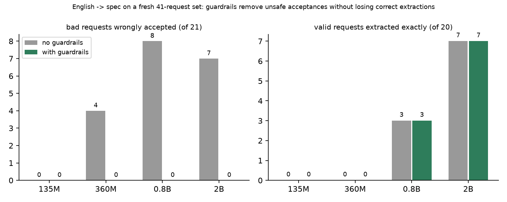
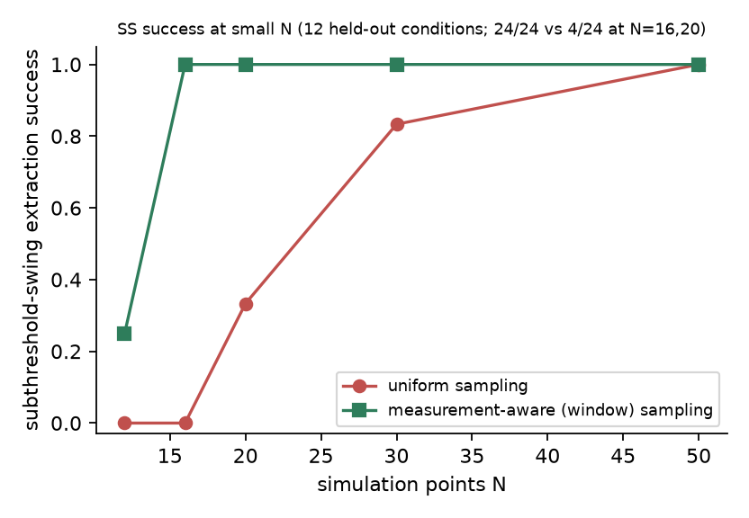
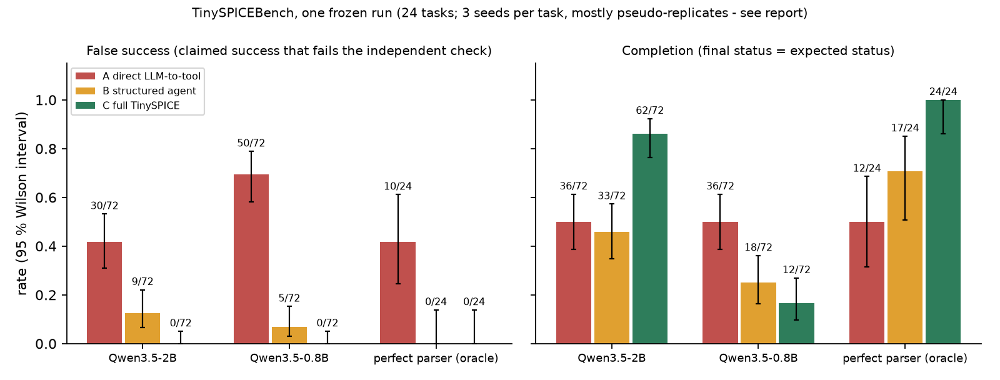

# TinySPICE: a budget-aware, reliability-driven LLM agent for reproducible MOSFET characterization

**Pavan D** · November 2026 · code, raw results and pre-registrations: this repository · single author

## Abstract
LLM agents that drive circuit simulators usually report success whenever the tool exits cleanly. TinySPICE restricts the language model to one job, turning an English request into a typed spec, and puts everything else in deterministic code: validation, planning inside hard budgets, real ngspice runs, measurement extraction, bounded recovery from named failures, and an evidence-checked final status. On a 24-task benchmark with independent ground truth, a direct LLM-to-tool baseline claimed success falsely in 30 of 72 runs (Qwen3.5-2B); the full system did so in 0 of 72 and completed 86 % of tasks. A measurement-aware sampling strategy raised subthreshold-swing extraction from 4/24 to 24/24 at small point counts. Two ideas failed under pre-registered tests (curvature-adaptive sampling; an LLM re-ask) and are reported as negative results. All numbers reproduce with one command. The evidence is one device family, one process corner and 24 tasks written by one author; it supports a trend, not a general claim.

## 1. Problem and honest positioning
Asking a model "characterize this MOSFET" and executing its tool call has three failure modes: it invents conditions the user never gave, it ignores stated budgets, and it reports success when a measurement silently failed. "LLM plus SPICE" is not new (for example AnalogAgent, arXiv 2603.23910). The narrower contributions claimed here are: (1) hard budgets enforced before each action; (2) bounded recovery from named failures with honest status labels; (3) a measured comparison of guardrails around small local models; (4) measurement-aware sampling. The design rule is simple: the model never supplies a number that code does not check, unstated values are rejected rather than defaulted, and a run is `successful` only if every requested measurement succeeded.

## 2. System
Request text -> **parser** (local llama.cpp model, constrained JSON, the only LLM step) -> **guardrails** (every extracted number must appear in the request after unit conversion and sit next to its own keyword; named measurements must be covered; stated biases and limits must not be dropped; contradictions are refused) -> typed **spec** -> deterministic **planner** (device limits, point and tool-call budgets) -> **ledger-enforced run** on real ngspice 47 with SKY130 models -> **measurement engine** (VTH, SS, GM, GDS, ION, IOFF, ID) -> **recovery catalogue** (named faults, bounded retries, never touching `gmin` or `abstol`) -> six-state **status machine** -> **SQLite provenance** with artefact hashes, replay and verify. Note: measurement code is shared by every benchmark configuration so that the benchmark isolates orchestration.

## 3. Results
Every number below is recomputed from committed raw files by `python scripts/reproduce.py results`.

### 3.1 English to spec: safe, but recall is limited
On a fresh 41-request set (20 valid, 21 bad) written before any model saw it, Qwen3.5-2B extracted 7/20 valid requests exactly. Without guardrails it accepted 7/21 bad requests and produced 4 silently wrong specs; with them, 0/21 and 0, with no correct extraction lost (figure 3). Smaller models (135M, 360M) extracted almost nothing; 0.8B reached 3/20. A small local model behind deterministic guards is safe and not convenient.



### 3.2 Measurement-aware sampling (confirmed, held out)
Subthreshold swing needs points inside the exponential region. Curvature-adaptive sampling did not help (pre-registered hypothesis H4 not supported). A sampler that targets the SS extractor's window did: on 12 held-out conditions (24 paired cells at 16 and 20 points) SS extraction succeeded in 24/24 with window sampling against 4/24 with uniform sampling (discordant pairs 20:0, one-sided sign test p = 1e-6), with VTH within 1.2 mV and a 0.2 to 1.5 % GM cost against a 5 % tolerance. The benefit is tied to the extractor's window definition.



### 3.3 Reliability and provenance
Twenty failure-injection cases, with expected statuses committed before any code existed, all produce the right status on real ngspice. The suite found real defects along the way: a status table that called an unhandled fault with a good-looking result "successful", and a 50-point sweep that silently returned 49 rows. Replay reproduces stored measurements within rtol 1e-6 and `verify` detects tampering. Limit: no physical non-convergence could be provoked (24 hostile runs all converged), so the solver-ladder cure was verified only against an injected fault.

### 3.4 TinySPICEBench
24 tasks in four groups (understanding, planning, measurement, reliability), 3 seeds each, three configurations given the identical model output: **A** direct LLM-to-tool with naive success reporting, **B** spec validation and planner only, **C** full system. Tasks and expected statuses were frozen with a hash before the baselines existed; ground truth is re-derived from the gold spec and a dense reference sweep.



| Qwen3.5-2B, 72 runs per config | A direct | B structured | C full |
|---|---|---|---|
| Completion | 0.50 | 0.46 | **0.86** |
| False success | 30 | 9 | **0** |
| Budget violations | 7 | 3 | 0 |

The pre-registered primary test (C versus A on false success) is supported: at task level A-only 10, C-only 0, exact one-sided sign test p = 0.001, task-cluster 95 % interval of the difference [+0.21, +0.63]. The three seeds are mostly pseudo-replicates (18 of 24 tasks gave identical outputs across seeds), so the task-level test is the honest one and the pair-level p-value in the raw report overstates the evidence. Of A's 30 false successes, 24 are tasks where the right answer was to refuse or stop; the property measured is therefore "refuses and stops when it should". With a perfect parser, A still falsely succeeded in 42 % of runs while B and C did not, so most of A's errors are orchestration, not language understanding. With the 0.8B model C stays safe (0 false successes) but completes only 17 % of runs. All 26 of C's success claims were true.

### 3.5 Negative results
Curvature-adaptive sampling: not supported. Bounded LLM re-ask on stray fields: recall rose 0.667 to 0.714 (below the pre-registered +0.05), and pruning or re-asking let a contradictory request become a valid spec, failing the safety condition. The cause (a guard that missed the phrasing "also held at") was fixed and verified on a fresh set (contradictions accepted under pruning 5/36 to 0/36 and 6/36 to 0/36, no correct extraction lost), and the re-ask stays out of the system.

## 4. Limits
One author wrote the tasks, system and baselines; freezing, pre-registration and tasks the system is expected to fail mitigate this but do not remove it. 24 tasks, one device family (SKY130 1.8 V NFET), one corner, one platform (Windows 11). Voltage and temperature device limits are conventions; only geometry limits were verified from the model bins. Parser recall is about 35 %. Seeds are mostly pseudo-replicates. Convergence recovery was never exercised by a physical failure. Errors found late and corrected on the record: an overstated p-value (above), a fresh-set item I mislabelled as a parser hole, and a git line-ending setting that broke the frozen hashes on a fresh clone (found by cloning, fixed with `.gitattributes`).

## 5. Reproduce
```
python -m venv .venv && .venv\Scripts\python -m pip install -e .[dev]
.venv\Scripts\python scripts\setup_tools.py        # ngspice + SKY130, hash-pinned
.venv\Scripts\python scripts\reproduce.py all      # tests, a real run, verify, replay, every table above
```
From a clean clone this passes 18/18 checks. A transcript of a real session is in `docs/DEMO.md`; every decision and amendment is in `docs/DECISIONS.md` and the `*PREREG*.md` files.
