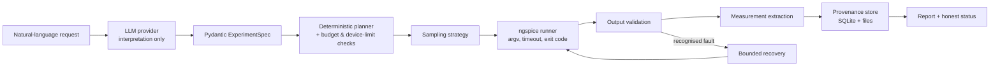

# System Architecture

## Separation of concerns
- **Reasoning layer** (`providers/`, `agent/`): turns text into a spec; can propose a plan. Cannot run commands.
- **Deterministic layer** (`schemas/`, `planner/`, `simulator/`, `measurements/`, `sampling/`, `budget/`, `recovery/`, `provenance/`): all science and all enforcement.
- **Simulator abstraction**: interface with `NgspiceSimulator` and `MockSimulator`, so tests need no ngspice.
- **Controlled tool interface**: the agent may only call registered tools with validated arguments. No shell strings from model output.

## Status states
successful · failed · partially_completed · recovered_after_failure · rejected_invalid_input · stopped_budget_limit.
SUCCESSFUL requires validated simulator output AND successful extraction of every requested measurement.

## Module status
schemas, planner, simulator, measurements, sampling, budget, recovery, status, provenance, parser and CLI are implemented; see PROJECT_STATUS.md for the current per-component status. PMOS and other PDKs are NOT IMPLEMENTED.
